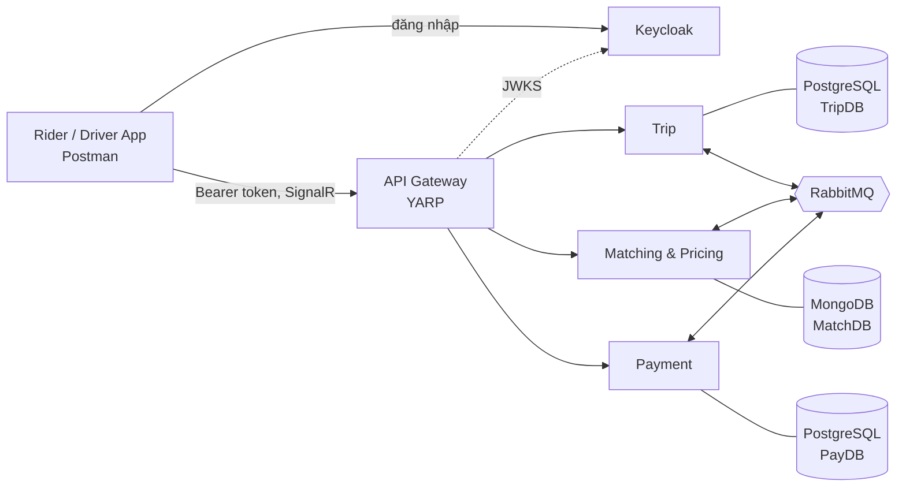

# SwiftRide

SwiftRide là bài tập lớn môn **Kiến trúc Phần mềm** (Trường Đại học Sài Gòn, HK I 2026–2027). Hệ thống mô phỏng sàn đặt xe hai phía, kết nối **rider** (người đi) và **driver** (tài xế), xây dựng theo kiến trúc **microservices** trên **.NET 10**.

📄 **Báo cáo kiến trúc đầy đủ:** [docs/architecture-report.md](docs/architecture-report.md). Báo cáo đi theo 9 mục của đề và có sơ đồ, SOLID, design pattern, trade-off, bằng chứng kiểm thử.

## 1. Thành phần

| Thành phần | Vai trò | Công nghệ / dữ liệu |
|---|---|---|
| **API Gateway** | Điểm vào duy nhất, định tuyến, xác thực JWT, proxy SignalR | YARP |
| **Keycloak** | Identity Provider: đăng ký, đăng nhập, vai trò Rider/Driver/Admin, cấp token RS256 | Keycloak 26 (OAuth 2.0 / OIDC) + PostgreSQL riêng |
| **Trip Service** | Vòng đời chuyến (State pattern), lời mời tài xế, điều phối Saga, SignalR | PostgreSQL `TripDB` |
| **Matching & Pricing Service** | Tìm và giữ chỗ tài xế bằng geo-query, tính giá (Strategy) | MongoDB `MatchDB` |
| **Payment Service** | Thanh toán qua message, sổ cái kép, idempotency, refund | PostgreSQL `PayDB` |
| **RabbitMQ** | Command/event giữa các service, Transactional Outbox/Inbox | RabbitMQ 4 + MassTransit 8 |
| **Mobile** | App Rider và Driver | React Native + Expo + TypeScript (`mobile/`) |

## 2. Kiến trúc



- **Database-per-service:** mỗi service sở hữu CSDL riêng và không đọc CSDL của service khác.
- **Giao tiếp đồng bộ (REST):** chỉ dùng khi cần trả lời ngay, gồm client gọi qua Gateway, lấy giá nội bộ và đọc snapshot chuyến.
- **Giao tiếp bất đồng bộ (RabbitMQ):** dùng cho các bước nghiệp vụ, gồm tìm tài xế, nhả tài xế, thanh toán và kết quả thanh toán.

## 3. Luồng nghiệp vụ

1. Rider đặt xe (`POST /api/trips`). Trip lấy giá do server tính rồi lưu chuyến ở trạng thái `Requested`.
2. Rider xác nhận giá (`confirm-price`) hoặc hủy.
3. Matching tìm tài xế gần nhất trên MongoDB và giữ chỗ nguyên tử. Trip gửi lời mời cho tài xế qua SignalR.
4. Tài xế nhận hoặc từ chối. Khi từ chối hoặc hết giờ, hệ thống nhả tài xế, tăng `declineCount` và thử người khác; chuyến chỉ `Failed` khi `declineCount > k`. Ngưỡng `k` (`DeclineThreshold`, mặc định 2), TTL lời mời và bán kính nằm trong [config/trip/trip-matching.json](config/trip/trip-matching.json): sửa file là có hiệu lực ngay, không cần restart (xem `GET /api/trips/matching-settings`).
5. Tài xế cập nhật `enroute` → `pickup` → `dropoff`.
6. Dropoff chuyển chuyến sang `PaymentPending` và phát `TripDroppedOffV1` (qua Outbox, cùng transaction). **Saga thanh toán** nhận event và gửi `ProcessPaymentV1`.
7. Payment ghi sổ cái và phát kết quả: chuyến thành `Paid` khi thành công, `Failed` khi bị từ chối. Quá hạn chờ (mặc định 10 phút) thì saga chuyển chuyến sang `Failed`; nếu tiền về muộn, saga tự gửi lệnh hoàn tiền (bù trừ).
8. Admin có thể hoàn tiền (`refund`) cho payment đã thành công.

Sơ đồ trạng thái và luồng message chi tiết: [báo cáo, mục 4](docs/architecture-report.md#4-flowchart-vòng-đời-một-chuyến-đi).

## 4. Chạy project

### Yêu cầu

- .NET 10 SDK (`global.json` ghim 10.0.300, cho phép roll-forward)
- Docker Desktop hoặc Docker Engine có Docker Compose 2.24.4 trở lên
- Tùy chọn: Python 3 (system test), PowerShell 7 (nghiệm thu Gateway), Node.js 22 (Newman, mobile)

### Khởi động toàn bộ backend

```bash
docker compose up --build -d
```

Compose có sẵn giá trị mặc định cho môi trường dev. Muốn đổi mật khẩu hoặc khóa, copy `.env.example` thành `.env` rồi sửa; **không commit `.env`**.

Lần đầu khởi động, Keycloak mất khoảng 20–40 giây để import realm. Gateway chỉ báo sẵn sàng khi đọc được Keycloak:

```bash
curl http://localhost:5100/health/ready
```

| Địa chỉ | Thành phần |
|---|---|
| http://localhost:5100 | API Gateway (mọi API nghiệp vụ dưới `/api/*`) |
| http://localhost:8180 | Keycloak (đăng nhập, Admin Console tại `/admin`) |
| http://localhost:15672 | RabbitMQ Management |
| `localhost:5101` / `5102` / `5103` | Trip / Matching / Payment (gọi trực tiếp vẫn phải có JWT) |
| `localhost:5433` / `27017` / `5434` | PostgreSQL Trip / MongoDB / PostgreSQL Payment |

### Tài khoản demo (realm Keycloak, chỉ dùng cho dev)

Mật khẩu mặc định của tất cả tài khoản: `SwiftRide-demo-2026!`.

| Email | Vai trò |
|---|---|
| rider.demo@example.com, rider.other@example.com | Rider |
| driver.demo@example.com, driver.other@example.com | Driver |
| admin.demo@example.com | Admin (refund) |

Lấy token để thử API (client `swiftride-postman` chỉ dành cho dev/test):

```bash
curl -s -X POST http://localhost:8180/realms/swiftride/protocol/openid-connect/token \
  -d grant_type=password -d client_id=swiftride-postman \
  -d username=rider.demo@example.com --data-urlencode "password=SwiftRide-demo-2026!"
```

App mobile đăng nhập bằng Authorization Code + PKCE (client `swiftride-mobile`). Chi tiết: [docs/gateway-auth.md](docs/gateway-auth.md).

### Dừng

```bash
docker compose down        # giữ dữ liệu
```

Không dùng `down -v` nếu muốn giữ dữ liệu.

## 5. Kiểm thử

| Bộ test | Lệnh | Phạm vi |
|---|---|---|
| Unit / HTTP cục bộ | `dotnet test --solution SwiftRide.sln -- --filter-not-trait Category=Integration` | Domain, application, bảo mật endpoint, Gateway thật + SignalR |
| Postman / Newman | Xem [postman/README.md](postman/README.md) | 73 request: đăng nhập Keycloak, token giả, vòng đời chuyến, reject → đổi tài xế, thanh toán, refund |
| System / recovery | `python tests/System/messaging.py --dotnet dotnet` | 25 kịch bản trên stack Docker riêng: message trùng, kill service, restart broker/CSDL, replay lỗi |
| Nghiệm thu Gateway + Keycloak | `pwsh -NoProfile -File tests/Gateway.Security/task1.ps1` | Token qua restart, readiness, logout, phân quyền, cô lập SignalR |

CI (GitHub Actions) chạy build, unit test, system suite và nghiệm thu Gateway khi push lên `main` và trên mỗi pull request.

## 6. Cấu trúc thư mục

```text
SwiftRide/
├── src/
│   ├── ApiGateway/                # YARP + xác thực JWT (Keycloak)
│   ├── TripService/               # Domain / Application / Infrastructure / Api / Migrations
│   ├── MatchingService/           # Domain / Application / Infrastructure / Api
│   ├── PaymentService/            # Domain / Application / Infrastructure / Api
│   ├── SwiftRide.Contracts/       # Message contracts (…V1)
│   ├── SwiftRide.Messaging/       # Cấu hình MassTransit dùng chung
│   ├── SwiftRide.Messaging.Setup/ # Khởi tạo topology RabbitMQ
│   └── Shared/                    # ServiceSecurity: xác thực token Keycloak + token nội bộ
├── keycloak/                      # Realm swiftride (role, client, user demo)
├── mobile/                        # App Rider / Driver (React Native + Expo)
├── tests/                         # xUnit, system suite, nghiệm thu Gateway
├── postman/                       # Collection chấm API + environment
├── docs/                          # Báo cáo kiến trúc và tài liệu vận hành
├── docker-compose.yml
├── Directory.Packages.props       # Quản lý version NuGet tập trung
└── SwiftRide.sln
```

## 7. SOLID và design pattern (tóm tắt)

| Pattern / nguyên tắc | Ở đâu |
|---|---|
| **State** | `src/TripService/Domain/States` (vòng đời chuyến) |
| **Strategy** + Open/Closed | `src/MatchingService/Domain/Strategies` (Standard / Surge / Promo) |
| **Repository**, Interface Segregation | `ITripReader` / `ITripWriter`, `IDriverRepository`, `IPaymentRepository` |
| **Dependency Inversion** | Đăng ký DI trong `Program.cs` của từng service |
| **Transactional Outbox / Inbox**, Idempotent Consumer | MassTransit EF Outbox ở Trip và Payment |
| **Factory** | `PaymentMethodFactory` tạo phương thức Wallet / Card trong Payment |
| **Saga (orchestration)** + bù trừ | `TripPaymentStateMachine`: thanh toán sau trả khách, timeout, tự hoàn tiền khi tiền về muộn |
| **API Gateway** | `src/ApiGateway` |

Giải thích và ví dụ code: [báo cáo, mục 6–7](docs/architecture-report.md#6-áp-dụng-nguyên-tắc-solid).

## 8. Tài liệu

| Tài liệu | Nội dung |
|---|---|
| [docs/architecture-report.md](docs/architecture-report.md) | Báo cáo kiến trúc theo đề |
| [docs/gateway-auth.md](docs/gateway-auth.md) | Keycloak, xác thực và phân quyền |
| [docs/gateway-docker-test.md](docs/gateway-docker-test.md) | Chạy và thử Gateway trên Docker |
| [docs/messaging.md](docs/messaging.md) | Runbook RabbitMQ: topology, xử lý queue lỗi, replay |
| [docs/mobile-api-contract.md](docs/mobile-api-contract.md) | Hợp đồng API/SignalR cho mobile |
| [postman/README.md](postman/README.md) | Chạy bộ chấm API bằng Postman/Newman |
| [mobile/README.md](mobile/README.md) | Chạy app trên điện thoại, build Android |
| `docs/task*-results.md` | Kết quả kiểm thử theo từng giai đoạn |

## 9. Hạn chế hiện tại

- Payment là ledger mô phỏng, chưa tích hợp cổng thanh toán thật.
- Chưa có OpenTelemetry; hệ thống hiện chỉ có log có cấu trúc và health check.
- App mobile còn chạy ở chế độ demo, chưa nối API thật và Keycloak.
- Phí phụ (toll) đang bằng 0 và loại xe chưa ảnh hưởng tới giá.

Hướng phát triển: [báo cáo, mục 11](docs/architecture-report.md#11-hạn-chế-và-hướng-phát-triển).
