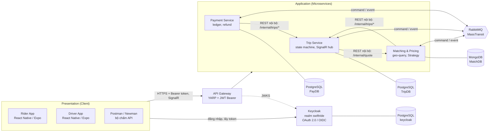
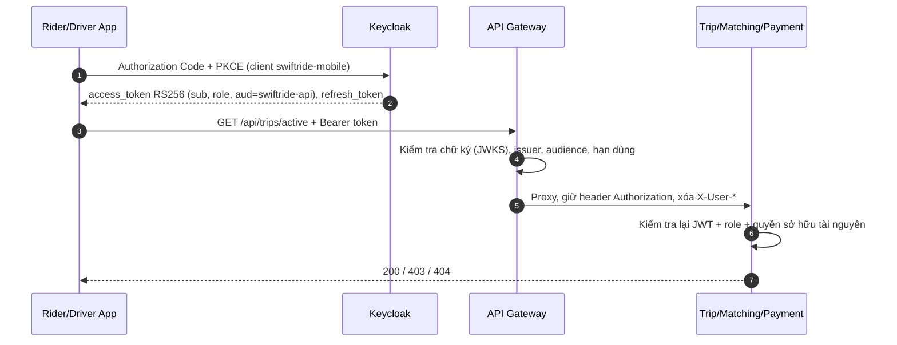
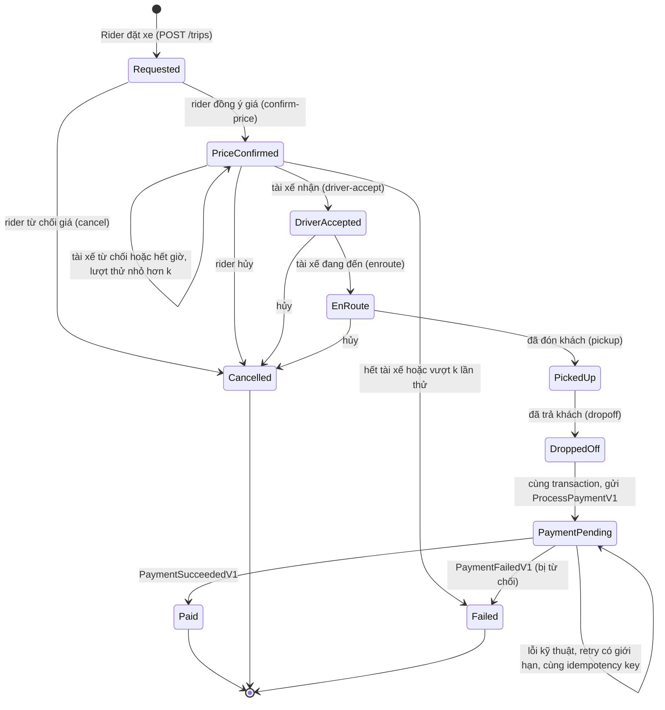
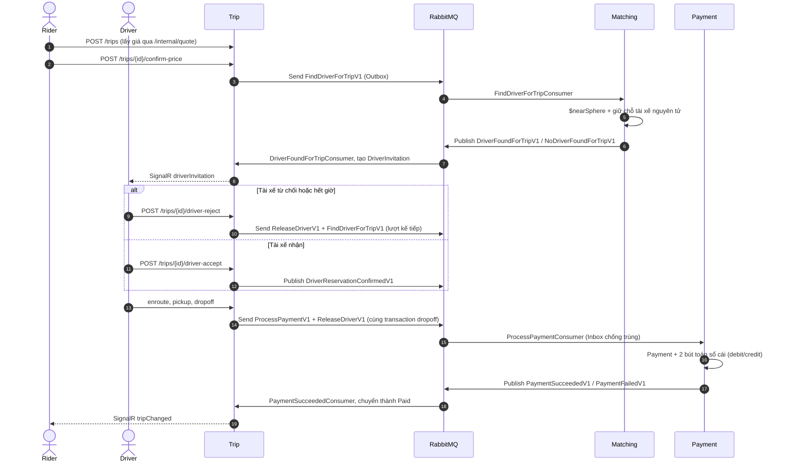

# Báo cáo kiến trúc phần mềm — SwiftRide

Môn: Kiến trúc Phần mềm · Học kỳ I, năm học 2026–2027 · Trường Đại học Sài Gòn, Khoa Công nghệ Thông tin

Tài liệu mô tả kiến trúc **đã được hiện thực** trong repository này, đối chiếu từng mục với đề bài "SwiftRide ver 1.0". Mọi tên lớp, endpoint và đường dẫn file đều lấy từ mã nguồn hiện tại; chỗ nào lệch so với đề đều được ghi rõ kèm lý do.

## Mục lục

1. [Tóm tắt](#1-tóm-tắt)
2. [Bài toán SwiftRide](#2-bài-toán-swiftride)
3. [Kiến trúc tổng quan và Client Architecture](#3-kiến-trúc-tổng-quan-và-client-architecture)
4. [Flowchart: vòng đời một chuyến đi](#4-flowchart-vòng-đời-một-chuyến-đi)
5. [Chi tiết ba microservice](#5-chi-tiết-ba-microservice)
6. [Áp dụng nguyên tắc SOLID](#6-áp-dụng-nguyên-tắc-solid)
7. [Design pattern sử dụng](#7-design-pattern-sử-dụng)
8. [Ngăn xếp công nghệ .NET và cấu trúc thư mục](#8-ngăn-xếp-công-nghệ-net-và-cấu-trúc-thư-mục)
9. [Trade-off và yêu cầu chất lượng](#9-trade-off-và-yêu-cầu-chất-lượng)
10. [Kiểm thử và bằng chứng](#10-kiểm-thử-và-bằng-chứng)
11. [Hạn chế và hướng phát triển](#11-hạn-chế-và-hướng-phát-triển)

---

## 1. Tóm tắt

SwiftRide là sàn đặt xe hai phía kết nối **rider** và **driver**, xây dựng theo kiến trúc **microservices** trên **.NET 10**.

| Yêu cầu bắt buộc của đề | Hiện thực |
|---|---|
| Tối đa 3 dịch vụ | **Trip Service**, **Matching & Pricing Service**, **Payment Service** |
| Payment Service là bắt buộc | Có; thanh toán qua message, ghi sổ cái kép, idempotency, refund |
| 3 cơ sở dữ liệu riêng | Trip → PostgreSQL `TripDB`; Matching → **MongoDB** `MatchDB`; Payment → PostgreSQL `PayDB`. Mỗi service một instance/database riêng (database-per-service) |

Ngoài phần bắt buộc, hệ thống có thêm các phần mở rộng mà đề nêu:

- **API Gateway**: YARP (Yet Another Reverse Proxy).
- **Identity Provider**: Keycloak (OAuth 2.0 / OpenID Connect).
- **Message broker**: RabbitMQ qua MassTransit.
- **Transactional Outbox/Inbox**.
- **Saga dạng choreography** có hành động bù trừ.
- Cập nhật thời gian thực qua **SignalR**.
- Chạy toàn bộ bằng **Docker Compose**.
- Kiểm thử nhiều tầng: unit, integration, system/recovery, Postman.

---

## 2. Bài toán SwiftRide

### 2.1 Bối cảnh

Giá trị cốt lõi là **độ tin cậy**. Hệ thống phải:

- Không giao một tài xế cho hai chuyến cùng lúc.
- Không trừ tiền hai lần.
- Không làm mất trạng thái khi một thành phần bị khởi động lại.

### 2.2 Kịch bản end-to-end đã hiện thực

| Bước theo đề | Hiện thực trong SwiftRide | Thành phần chịu trách nhiệm |
|---|---|---|
| 1. Đặt xe | `POST /api/trips` qua Gateway (token Keycloak, role Rider). `RiderId` lấy từ token, không lấy từ body | Gateway → Trip |
| 2. Tạo chuyến | Trip gọi nội bộ `POST /internal/quote` để lấy giá do server tính, lưu chuyến ở trạng thái `Requested`. Có idempotency key chống tạo trùng | Trip, Matching |
| 3. Tìm tài xế và báo giá | Giá trả ngay khi tạo chuyến. Sau khi rider xác nhận, Trip gửi command `FindDriverForTripV1`; Matching tìm tài xế gần nhất bằng `$nearSphere` trên MongoDB và **giữ chỗ** tài xế một cách nguyên tử | Trip, Matching |
| 4. Rider xác nhận giá | `POST /api/trips/{id}/confirm-price` chuyển chuyến sang `PriceConfirmed`. Rider từ chối thì gọi `cancel` và chuyến thành `Cancelled` | Trip |
| 5. Đề xuất cho tài xế | Matching phát `DriverFoundForTripV1`; Trip tạo `DriverInvitation` và đẩy sự kiện SignalR `driverInvitation`. Khi tài xế từ chối (`driver-reject`) hoặc hết giờ: nhả tài xế, tăng lượt thử và tìm người khác, loại những tài xế đã mời. Vượt `TripMatching:MaxAttempts` (k = 3) thì chuyến thành `Failed` | Trip, Matching |
| 6. Thực hiện chuyến | `driver-accept` → `DriverAccepted`; `enroute` → `EnRoute`; `pickup` → `PickedUp`; `dropoff` → `DroppedOff`. Mỗi lần đổi trạng thái đều đẩy sự kiện `tripChanged` | Trip |
| 7. Thanh toán | Ngay khi dropoff, **trong cùng một transaction**: chuyến chuyển sang `PaymentPending` và command `ProcessPaymentV1` được ghi vào Outbox. Payment ghi sổ cái rồi phát `PaymentSucceededV1` hoặc `PaymentFailedV1` | Trip, Payment |
| 8. Kết thúc | Trip nhận kết quả: `Paid` (thành công) hoặc `Failed` (bị từ chối). Lỗi kỹ thuật giữ nguyên `PaymentPending` để xử lý lại | Trip |

### 2.3 Công thức tính giá

Đề bài:

$$p = \big((c_d \cdot d + c_t \cdot t)\cdot s + c_m\big)\cdot \eta \cdot (1+T)$$

Mã nguồn ([StandardPricingStrategy.cs](../src/MatchingService/Domain/Strategies/StandardPricingStrategy.cs)) cài đặt đúng công thức này:

```csharp
var operating = context.CostPerKm * context.DistanceKm + context.CostPerMinute * context.TimeMinutes;
return Math.Max(0m, (operating * context.SurgeMultiplier + context.Toll) * context.PromotionFactor * (1m + context.VatRate));
```

| Ký hiệu | Ý nghĩa | Nguồn giá trị |
|---|---|---|
| $c_d$, $c_t$ | Đơn giá theo km và theo phút | 12 và 2 (hằng số trong `PricingService`) |
| $s$ | Hệ số giá động (surge) | Collection `surge_rules` (MongoDB), chọn theo giờ địa phương |
| $c_m$ | Phí phụ (toll) | 0 (chưa có dữ liệu trạm thu phí) |
| $\eta$ | Hệ số khuyến mãi = 1 − tỉ lệ giảm | Collection `promo_codes`, mã được chuẩn hóa ở server |
| $T$ | Thuế | VAT 10% |

Client không gửi được giá: `fareEstimate` luôn do server tính.

### 2.4 Quyết định thiết kế: 3 microservice

1. **Trip Service**: quản lý vòng đời chuyến đi (state machine), lời mời tài xế, điều phối các bước nghiệp vụ.
2. **Matching & Pricing Service**: tìm và giữ chỗ tài xế (geo-query), tính giá theo Strategy.
3. **Payment Service** (bắt buộc): xử lý thanh toán, sổ cái, idempotency, hoàn tiền.

Ranh giới chia theo **bounded context**; mỗi service sở hữu dữ liệu của mình và không đọc database của service khác.

---

## 3. Kiến trúc tổng quan và Client Architecture

### 3.1 Sơ đồ kiến trúc logic (container diagram)



Giao tiếp **đồng bộ** (REST) chỉ dùng khi cần câu trả lời ngay: client gọi qua Gateway, lấy giá nội bộ, đọc snapshot chuyến. Mọi bước nghiệp vụ kéo dài hoặc có thể thất bại tạm thời đều đi **bất đồng bộ** qua RabbitMQ: tìm tài xế, nhả tài xế, thanh toán, kết quả thanh toán.

### 3.2 Các tầng trong Client Architecture

| Tầng | Hiện thực | Trách nhiệm |
|---|---|---|
| **Presentation (Client)** | `mobile/apps/rider`, `mobile/apps/driver` (React Native + Expo, dùng chung `mobile/shared`) | UI/UX, kiểm tra dữ liệu đầu vào. Mọi quy tắc nghiệp vụ quyết định vẫn kiểm tra lại ở server |
| **Identity** | Keycloak, realm `swiftride` ([keycloak/swiftride-realm.json](../keycloak/swiftride-realm.json)) | Đăng ký, đăng nhập (Authorization Code + PKCE cho app), cấp token RS256, quản lý vai trò Rider/Driver/Admin |
| **Edge / Gateway** | `src/ApiGateway` (YARP) | Điểm vào duy nhất, định tuyến, xác thực JWT trước khi proxy, xóa header `X-User-*` giả mạo, chuyển tiếp WebSocket SignalR |
| **Application (Microservices)** | `src/TripService`, `src/MatchingService`, `src/PaymentService` | Nghiệp vụ; mỗi service tự kiểm tra lại token và quyền trên tài nguyên |
| **Integration** | RabbitMQ + MassTransit; contracts trong `src/SwiftRide.Contracts` | Truyền command/event có version (`…V1`) |

### 3.3 API Gateway

Gateway dùng **YARP** (`Yarp.ReverseProxy`), đúng lựa chọn đề xuất của đề:

- Do Microsoft phát triển, chạy như middleware ASP.NET Core nên dùng chung pipeline xác thực/ủy quyền: mọi route khai báo `AuthorizationPolicy: "default"`, nên request không có JWT hợp lệ bị chặn 401 **ngay tại Gateway** trước khi proxy.
- Route và cluster khai báo trong mục `ReverseProxy` của [appsettings.json](../src/ApiGateway/appsettings.json); Compose chỉ ghi đè địa chỉ cluster (`ReverseProxy__Clusters__trip__Destinations__primary__Address`…).
- Path transform (`PathRemovePrefix`, `PathSet`) ánh xạ URL công khai sang URL của service.
- Request transform [IdentityHeaders.cs](../src/ApiGateway/Proxy/IdentityHeaders.cs) xóa header `X-User-*` và cookie do client gửi, gắn lại danh tính đã xác thực để quan sát; header `Authorization` được giữ để service kiểm tra lại.
- Proxy WebSocket cho SignalR có sẵn, không cần cấu hình thêm.

Ghi chú: phiên bản đầu dùng Ocelot; nhóm chuyển sang YARP để bám đề xuất của đề và thống nhất pipeline bảo mật với ASP.NET Core.

| Gateway (public) | Service đích |
|---|---|
| `/api/trips/*` | Trip `/trips/*` |
| `/api/hubs/trips` (WebSocket) | Trip `/hubs/trips` |
| `POST /api/matching/quote`, `POST /api/matching/match` | Matching `/quote`, `/match` |
| `POST /api/drivers/location` | Matching `/api/drivers/location` |
| `/api/payments/*` | Payment `/payments/*` |

Không có route public nào dẫn vào `/internal/*`. Hệ thống dùng **một** Gateway chung, không tách BFF riêng cho Rider và Driver, vì hai app đang dùng cùng một bộ API.

### 3.4 Ba cơ sở dữ liệu khác nhau

| Service | CSDL | Dữ liệu chính | Lý do |
|---|---|---|---|
| Trip | **PostgreSQL** (`trip-postgres`) | `Trips`, `DriverInvitations`, bảng Outbox/Inbox của MassTransit | Trạng thái chuyến cần ACID, ràng buộc unique (một lời mời cho mỗi `(TripId, Attempt)`), optimistic concurrency bằng `xmin` |
| Matching & Pricing | **MongoDB** (`matching-mongodb`) | `drivers` (GeoJSON + chỉ mục `2dsphere`), `surge_rules`, `promo_codes` | Vị trí tài xế ghi/đọc liên tục, cần geo-query `$nearSphere`; cập nhật nguyên tử bằng `FindOneAndUpdate` để giữ chỗ |
| Payment | **PostgreSQL** (`payment-postgres`) | `Payments`, `LedgerEntries`, Outbox/Inbox | Sổ cái kép cần transaction mạnh, unique theo idempotency key, phục vụ kiểm toán |

**Lệch so với đề:** đề gợi ý SQL Server cho Trip, nhóm dùng PostgreSQL. Đề cho phép "dùng cùng một loại CSDL nhưng tách schema/database theo service". Ở đây Trip và Payment chạy hai **instance** PostgreSQL riêng, Matching dùng MongoDB. Hệ thống vẫn là polyglot persistence (quan hệ + document) nhưng chỉ phải vận hành hai công nghệ CSDL thay vì ba.

### 3.5 Xác thực và phân quyền



- Vai trò được cấp **trong Keycloak**, không có API công khai nào để tự nâng quyền. Người tự đăng ký luôn chỉ là Rider.
- Service **không tin** header `X-User-*`. Gọi thẳng vào service mà không có JWT hợp lệ sẽ nhận 401.
- Gọi giữa các service dùng token nội bộ riêng (HS256, issuer `SwiftRide.Services`, sống 1 phút), không dùng chung với token người dùng.

Chi tiết: [gateway-auth.md](gateway-auth.md).

---

## 4. Flowchart: vòng đời một chuyến đi

### 4.1 Máy trạng thái (khớp code trong `src/TripService/Domain/States`)



Đối chiếu với flowchart của đề:

| Nhánh trong đề | Trạng thái trong code |
|---|---|
| Rider từ chối giá → "Kết thúc: Hủy chuyến" | `Requested → Cancelled` |
| Tài xế từ chối, chưa quá k lần → quay lại tìm tài xế | Ở lại `PriceConfirmed`, `MatchingAttempt` tăng, gửi lại `FindDriverForTripV1` và loại các tài xế đã mời |
| Tài xế từ chối quá k lần → "Không thành công" | `PriceConfirmed → Failed` |
| "Thanh toán lỗi / chờ xử lý" | `PaymentPending`: lỗi kỹ thuật được MassTransit retry 1s/3s/5s với cùng idempotency key; vẫn lỗi thì message vào `_error` và chuyến **giữ nguyên** `PaymentPending` để xử lý lại, không trừ tiền lặp và không báo thành công sai |
| "Thanh toán hoàn tất → Kết thúc: Thành công" | `Paid` |

### 4.2 Luồng message giữa các service



---

## 5. Chi tiết ba microservice

Ký hiệu quyền: **R** = Rider, **D** = Driver, **A** = Admin, **S** = token nội bộ của service.

### 5.1 Trip Service

**Trách nhiệm:** khởi tạo chuyến, giữ và chuyển trạng thái (State pattern), quản lý lời mời tài xế và thời hạn mời (`DriverInvitationTimeoutWorker`), điều phối Saga, đẩy thông báo SignalR (`TripNotificationHub`).

| Endpoint (qua Gateway `/api`) | Quyền | Mô tả |
|---|---|---|
| `POST /trips` | R | Tạo chuyến (idempotency key), giá lấy từ Pricing |
| `GET /trips/{id}` | R/D sở hữu | Chi tiết chuyến |
| `GET /trips/active` | R/D | Chuyến đang chạy để khôi phục app |
| `GET /trips/driver/invitations` | D | Lời mời còn hạn của chính tài xế |
| `POST /trips/{id}/confirm-price` | R sở hữu | Xác nhận giá, bắt đầu matching (202) |
| `POST /trips/{id}/driver-accept` · `driver-reject` | D được mời | Nhận / từ chối lời mời |
| `POST /trips/{id}/enroute` · `pickup` · `dropoff` | D được giao | Cập nhật hành trình; dropoff trả 202 |
| `POST /trips/{id}/cancel` | R sở hữu | Hủy chuyến (state machine quyết định có hợp lệ không) |
| `/internal/trips/{id}`, `/internal/trips/{id}/invitations`, `/internal/trips/{id}/pay` | S | Snapshot và callback nội bộ, không public |

Consumers: `DriverFoundForTripConsumer`, `NoDriverFoundForTripConsumer`, `PaymentSucceededConsumer`, `PaymentFailedConsumer`, `PaymentFaultConsumer`.

So với API tiêu biểu trong đề (`POST /trips`, `/driver-accept`, `/pickup`, `/dropoff`): có đủ, và có thêm `confirm-price`, `driver-reject`, `enroute`, `cancel` để phủ hết flowchart.

### 5.2 Matching & Pricing Service

**Trách nhiệm:** nhận vị trí GPS của tài xế, tìm tài xế gần nhất còn trống và mới cập nhật vị trí, giữ chỗ nguyên tử theo `(TripId, Attempt)`, nhả chỗ khi có lệnh. Tính giá bằng các Strategy. `ReservationRecoveryWorker` đối chiếu định kỳ các chỗ giữ quá hạn với trạng thái thật của chuyến.

| Endpoint | Quyền | Mô tả |
|---|---|---|
| `POST /api/matching/quote` | R | Báo giá tham khảo (Standard / Surge / Promo) |
| `POST /api/matching/match` | R sở hữu chuyến | Trả danh sách ứng viên, không tạo lời mời |
| `POST /api/drivers/location` | D | Cập nhật vị trí và trạng thái online; DriverId lấy từ token |
| `POST /internal/quote` | S (trip-service) | Trip lấy giá chuẩn khi tạo chuyến |

Consumers: `FindDriverForTripConsumer`, `ReleaseDriverConsumer`, `DriverReservationConfirmedConsumer`, `DriverReservationReleasedConsumer`.

### 5.3 Payment Service

**Trách nhiệm:**

- Nhận command `ProcessPaymentV1` và đối chiếu với snapshot chuyến từ Trip: số tiền, tài khoản, trạng thái.
- Tạo `Payment` kèm **hai bút toán** `LedgerEntry` (debit tài khoản rider, credit tài khoản tài xế).
- Phát kết quả thanh toán.
- **Idempotency:** cùng một idempotency key chỉ tạo một payment; message trùng chỉ phát lại kết quả đã lưu.
- **Refund:** tạo hai bút toán đảo ngược và dùng optimistic concurrency (`Version`) để chặn refund hai lần.

Hệ thống chỉ lưu định danh tài khoản (`rider-{id}`, `driver-{id}`); không lưu số thẻ hay CVV.

| Endpoint | Quyền | Mô tả |
|---|---|---|
| `GET /api/payments/{id}` | R sở hữu chuyến, A | Xem payment |
| `GET /api/payments/trip/{tripId}` | R sở hữu, A | Payment của một chuyến |
| `POST /api/payments/{id}/refund` | **A** | Hoàn tiền; gọi lần hai trả 409 |

Consumer: `ProcessPaymentConsumer`, dùng EF Outbox/Inbox với cửa sổ chống trùng 24 giờ.

**Lệch so với đề:** đề nêu `POST /payments`. Nhóm **cố ý không mở** endpoint tạo payment công khai: thanh toán chỉ được khởi tạo từ sự kiện dropoff trong Trip. Nhờ vậy client không thể tự tạo hoặc lặp thanh toán, và số tiền luôn lấy từ giá server đã chốt.

---

## 6. Áp dụng nguyên tắc SOLID

### 6.1 S — Single Responsibility

Mỗi lớp có đúng một lý do để thay đổi. Việc tính giá, chọn chiến lược, lưu trữ và điều phối được tách riêng:

| Lớp | Trách nhiệm duy nhất |
|---|---|
| `StandardPricingStrategy`, `SurgePricingStrategy`, `PromoPricingStrategy` | Áp công thức giá |
| `PricingService` | Lấy surge/promo từ MongoDB, kiểm tra input, chọn strategy |
| `TripRepository` | Truy xuất bảng `Trips` |
| `TripApplicationService` | Điều phối use case, không chứa SQL |
| `MessagePublisher` | Gửi/phát message, không chứa nghiệp vụ |

```csharp
// src/MatchingService/Domain/Strategies/StandardPricingStrategy.cs — chỉ tính giá
public sealed class StandardPricingStrategy : IPricingStrategy
{
    public decimal CalculatePrice(PricingContext context)
    {
        var operating = context.CostPerKm * context.DistanceKm + context.CostPerMinute * context.TimeMinutes;
        return Math.Max(0m, (operating * context.SurgeMultiplier + context.Toll) * context.PromotionFactor * (1m + context.VatRate));
    }
}
```

### 6.2 O — Open/Closed

Muốn thêm một chiến lược giá chỉ cần thêm một lớp cài đặt `IPricingStrategy` và đăng ký vào DI. Các lớp đang có không phải sửa.

```csharp
// src/MatchingService/Program.cs
builder.Services.AddScoped<IPricingStrategy, StandardPricingStrategy>();
builder.Services.AddScoped<IPricingStrategy, SurgePricingStrategy>();
builder.Services.AddScoped<IPricingStrategy, PromoPricingStrategy>();
// PricingService nhận IEnumerable<IPricingStrategy>
```

Tương tự, thêm một trạng thái chuyến mới chỉ cần thêm một lớp con của `TripState`.

### 6.3 L — Liskov Substitution

Mọi `IPricingStrategy` đều tuân thủ cùng một hợp đồng: **giá không âm**, nhận cùng `PricingContext`. Hậu điều kiện này được đặt trong từng cài đặt (`Math.Max(0m, …)`) và được kiểm thử trong `PricingStrategyTests`, nên `PricingService` có thể thay strategy này bằng strategy khác mà không đổi hành vi mong đợi.

Với `TripState`, mọi lớp con đều trả về `TripState` hợp lệ hoặc ném `InvalidOperationException` cho chuyển trạng thái không hợp lệ. Lời gọi `trip.Pickup()` hoạt động thống nhất với mọi trạng thái.

### 6.4 I — Interface Segregation

Quyền đọc và quyền ghi trên chuyến được tách thành hai interface nhỏ, đúng như ví dụ trong đề:

```csharp
// src/TripService/Domain/Interfaces/ITripReader.cs
public interface ITripReader
{
    Task<Trip?> GetByIdAsync(Guid id, CancellationToken ct = default);
    Task<Trip?> GetByIdempotencyKeyAsync(string idempotencyKey, CancellationToken ct = default);
    Task<Trip?> GetActiveTripAsync(Guid userId, string role, CancellationToken ct = default);
}
// src/TripService/Domain/Interfaces/ITripWriter.cs
public interface ITripWriter
{
    Task AddAsync(Trip trip, CancellationToken ct = default);
    Task SaveAsync(Trip trip, CancellationToken ct = default);
}
```

Các nghiệp vụ khác cũng được tách thành interface riêng thay vì dồn vào một "repository béo":

- `ITripWorkflowRepository`: lời mời tài xế.
- `ITripUnitOfWork`: transaction.
- `ITripNotifier`: SignalR.
- `IMatchingPricingClient`: gọi Pricing.

### 6.5 D — Dependency Inversion

Tầng Application chỉ phụ thuộc vào abstraction; phần cài đặt cụ thể (EF Core/PostgreSQL, SignalR, MassTransit) được gắn vào ở `Program.cs`:

```csharp
// src/TripService/Program.cs
builder.Services.AddScoped<ITripReader, TripRepository>();
builder.Services.AddScoped<ITripWriter, TripRepository>();
builder.Services.AddScoped<ITripWorkflowRepository, TripWorkflowRepository>();
builder.Services.AddScoped<ITripUnitOfWork, TripUnitOfWork>();
builder.Services.AddScoped<ITripNotifier, SignalRTripNotifier>();
builder.Services.AddScoped<ITripApplicationService, TripApplicationService>();
```

Lợi ích thấy được ngay trong kiểm thử: `TripApplicationServiceTests` thay các phụ thuộc bằng Moq mà không cần database hay broker. Payment làm tương tự với `IPaymentRepository`, `IPaymentDecisionService`, `ITripServiceClient`; Matching với `IDriverRepository`, `IDateTimeProvider`.

---

## 7. Design pattern sử dụng

| Pattern | Loại | Ứng dụng trong SwiftRide | Vị trí trong code |
|---|---|---|---|
| **State** | Behavioral | Vòng đời chuyến và các transition hợp lệ; trạng thái được khôi phục từ DB bằng `RehydrateState()` | `src/TripService/Domain/States/*State.cs`, `Trip.cs` |
| **Strategy** | Behavioral | Tính giá Standard / Surge / Promo | `src/MatchingService/Domain/Strategies/` |
| **Repository** | DDD | Trừu tượng hóa truy cập CSDL cho từng service | `TripRepository`, `TripWorkflowRepository`, `MongoDriverRepository`, `PaymentRepository` |
| **Unit of Work** | Enterprise | Gom thay đổi trạng thái và message Outbox vào một transaction | `ITripUnitOfWork` / `TripUnitOfWork` |
| **Observer / Pub-Sub** | Behavioral | Sự kiện domain qua RabbitMQ; SignalR đẩy `tripChanged`/`driverInvitation` | `SwiftRide.Messaging`, `TripNotificationHub` |
| **API Gateway** | Architectural | Một điểm vào cho client (YARP) | `src/ApiGateway` |
| **Saga (choreography)** | Architectural | Quy trình nhiều service với hành động bù trừ (mục 9.2) | Consumers trong Trip/Matching/Payment |
| **Transactional Outbox / Inbox** | Architectural | Ghi dữ liệu và message trong cùng transaction; chống xử lý trùng | MassTransit EF Outbox (Trip, Payment), migration `AddTripOutbox`, `AddPaymentConsumerOutbox` |
| **Idempotent Consumer** | Integration | Message trùng không tạo payment hay ledger thứ hai | `PaymentApplicationService`, unique index idempotency key |
| **Dependency Injection** | Creational | Gắn cài đặt cụ thể vào abstraction | `Program.cs` của mỗi service |
| **Factory** | Creational | Tạo đối tượng `PaymentMethod` (Wallet/Card) theo trường `PaymentMethod` của lệnh thanh toán | `src/PaymentService/Application/PaymentMethods/PaymentMethods.cs` (`PaymentMethodFactory`) |
| **Factory Method** | Creational | `Trip.Create(...)`, `Payment.Create(...)`, `LedgerEntry.Create(...)` bảo đảm thực thể sinh ra luôn hợp lệ | Domain entities |

**Factory cho PaymentMethod** (đúng ví dụ của đề). Lệnh `ProcessPaymentV1` mang trường `PaymentMethod` (`"Wallet"` hoặc `"Card"`; thiếu trường thì mặc định Wallet, nên message cũ vẫn tương thích). `PaymentMethodDecisionService` nhờ factory tạo đúng đối tượng rồi giao quyết định duyệt/từ chối cho nó; phần ghi sổ cái không đổi:

```csharp
// src/PaymentService/Application/PaymentMethods/PaymentMethods.cs
public sealed class PaymentMethodFactory : IPaymentMethodFactory
{
    public IPaymentMethod Create(PaymentMethodType type) => type switch
    {
        PaymentMethodType.Wallet => new WalletPaymentMethod(),
        PaymentMethodType.Card => new CardPaymentMethod(),
        _ => throw new ArgumentOutOfRangeException(nameof(type), type, "Phương thức thanh toán không được hỗ trợ.")
    };
}

// src/PaymentService/Application/Services/PaymentMethodDecisionService.cs
public Task<PaymentDecision> DecideAsync(TripSnapshot trip, CreatePaymentRequest request, CancellationToken ct) =>
    methods.Create(request.PaymentMethod).AuthorizeAsync(trip, request, ct);
```

Cả hai phương thức đều là mô phỏng: Wallet luôn duyệt; Card mô phỏng cổng thẻ với hạn mức 5.000.000 VND/giao dịch (vượt thì `PAYMENT_DECLINED`) và không lưu số thẻ. Thêm phương thức mới (ví dụ QR) chỉ cần một lớp `IPaymentMethod` và một nhánh trong factory (OCP). Hiện Trip luôn gửi `Wallet` vì app chưa có màn hình chọn phương thức.

---

## 8. Ngăn xếp công nghệ .NET và cấu trúc thư mục

### 8.1 Ngăn xếp công nghệ

| Thành phần | Đề xuất của đề | SwiftRide |
|---|---|---|
| Runtime / Framework | .NET 10 (LTS), ASP.NET Core | **.NET 10**, ASP.NET Core Minimal API; Gateway là YARP middleware |
| ORM / Data | EF Core 10 (SQL Server, PostgreSQL), MongoDB.Driver | **EF Core 10 + Npgsql**, **MongoDB.Driver 3** |
| API Gateway | YARP | **YARP 2.3** (`Yarp.ReverseProxy`) |
| Message Broker | RabbitMQ qua MassTransit | **RabbitMQ 4.1 + MassTransit 8.5** (EF Outbox/Inbox) |
| Xác thực | OAuth 2.0 / OIDC, JWT Bearer | **Keycloak 26** (OIDC, Authorization Code + PKCE), JWT Bearer RS256 qua JWKS |
| Realtime | — | **SignalR** (WebSocket qua Gateway) |
| Container | Docker + docker-compose | **Docker Compose**: 3 service, Gateway, Keycloak, 4 CSDL, RabbitMQ |
| Kiểm thử | xUnit + Moq | **xUnit v3 + Moq**, Python system suite, PowerShell acceptance, Postman/Newman |
| Quan sát | OpenTelemetry | Log có cấu trúc kèm `TripId`/`CorrelationId`/`MessageId`; **chưa có OpenTelemetry** (mục 11) |
| Client | — | React Native + Expo + TypeScript |

Phiên bản NuGet được quản lý tập trung trong `Directory.Packages.props`.

### 8.2 Cấu trúc thư mục

```text
SwiftRide/
├── src/
│   ├── ApiGateway/                # YARP, xác thực JWT (Keycloak), IdentityHeaders transform
│   ├── TripService/
│   │   ├── Domain/                # Trip, DriverInvitation, TripState (State pattern), ITripReader/Writer
│   │   ├── Application/           # TripApplicationService, consumers, DTOs, workers
│   │   ├── Infrastructure/        # EF Core + PostgreSQL, repositories, UnitOfWork, SignalR notifier
│   │   ├── Api/                   # Minimal API endpoints, SignalR hub
│   │   └── Migrations/
│   ├── MatchingService/
│   │   ├── Domain/                # DriverLocation, IPricingStrategy + 3 strategies
│   │   ├── Application/           # MatchingService, PricingService, consumers, recovery worker
│   │   ├── Infrastructure/        # MongoDB repository, seeder
│   │   └── Api/
│   ├── PaymentService/
│   │   ├── Domain/                # Payment, LedgerEntry, PaymentStatus
│   │   ├── Application/           # PaymentApplicationService, ProcessPaymentConsumer
│   │   ├── Infrastructure/        # EF Core + PostgreSQL, migrations, Trip client
│   │   └── Api/
│   ├── SwiftRide.Contracts/       # Message contracts có version (…V1)
│   ├── SwiftRide.Messaging/       # Cấu hình MassTransit dùng chung, topology, retry
│   ├── SwiftRide.Messaging.Setup/ # Khởi tạo topology RabbitMQ trước khi service chạy
│   └── Shared/ServiceSecurity.cs  # Xác thực token Keycloak + token nội bộ
├── keycloak/swiftride-realm.json  # Realm, role, client, user demo
├── mobile/                        # App Rider và Driver (React Native/Expo)
├── tests/
│   ├── TripService.Tests/  MatchingService.Tests/  PaymentService.Tests/   # xUnit + Moq
│   ├── Shared/TestOidcIssuer.cs   # Giả lập Keycloak (RS256, JWKS) trong test
│   ├── System/                    # Kịch bản recovery trên stack Docker thật
│   └── Gateway.Security/          # Nghiệm thu Gateway + Keycloak + SignalR
├── postman/                       # Collection chấm API (73 request) + environment
├── docs/                          # Tài liệu kiến trúc, auth, messaging, kết quả kiểm thử
├── docker-compose.yml
└── SwiftRide.sln
```

Cấu trúc bám sát mục 8.1 của đề (Domain / Application / Infrastructure / Api cho từng service) và có thêm các project dùng chung cho messaging.

---

## 9. Trade-off và yêu cầu chất lượng

### 9.1 Kiến trúc mã nguồn: microservices hay modular monolith

Như đề phân tích, với nhóm nhỏ thì modular monolith thường dễ phát triển hơn. Nhóm chọn microservices vì mục tiêu học tập, và đi theo lộ trình đề gợi ý:

1. Xác định bounded context (Trip / Matching & Pricing / Payment).
2. Chạy luồng cơ bản bằng REST.
3. Tách service và database.
4. Thêm messaging, Outbox và các kịch bản phục hồi.

Chi phí phải trả cho phân tán, và cách nhóm xử lý:

| Chi phí | Cách SwiftRide xử lý |
|---|---|
| Không có transaction xuyên service | Saga choreography + hành động bù trừ |
| Message có thể trùng hoặc đến muộn | Inbox, idempotency key, kiểm tra `Attempt` và trạng thái trước khi áp dụng |
| Service hoặc broker có thể chết giữa chừng | Outbox; consumer bền vững (durable queue); kịch bản kill/restart được kiểm thử |
| Vận hành nhiều thành phần | Một file Docker Compose; healthcheck cho CSDL, broker, Keycloak và readiness cho từng service |

### 9.2 Nhất quán và độ tin cậy

- **Strong consistency trong một service:** đổi trạng thái chuyến và ghi message được thực hiện trong cùng transaction PostgreSQL (`ITripUnitOfWork`). Tranh chấp được chặn bằng optimistic concurrency (`xmin` cho Trip, `Version` cho Payment).
- **Eventual consistency giữa các service:** đi qua command/event trên RabbitMQ.
- **Transactional Outbox:** dropoff ghi `PaymentPending` và `ProcessPaymentV1` vào Outbox cùng một commit; worker của MassTransit gửi message sau. Kịch bản kill Trip service hoặc ngắt broker ngay sau commit vẫn giao message đúng một lần (`dropoff-disconnect-restart`).
- **Consumer idempotent:** RabbitMQ giao *at least once*. Payment Inbox chống trùng theo MessageId trong 24 giờ, và unique index trên idempotency key chặn trùng theo nghiệp vụ (`duplicate-payment`: hai lần gửi chỉ tạo một payment và hai dòng ledger).
- **Retry và dead-letter:**
  - Lỗi tạm thời được retry 1s, 3s, 5s.
  - Lỗi dữ liệu (`ArgumentException`, `PaymentCommandRejectedException`) không retry.
  - Message vẫn lỗi được chuyển sang queue `_error` kèm MessageId gốc, sau đó có thể replay an toàn (`error-fault-replay`).
  - Mọi lời gọi HTTP nội bộ đều có timeout.
- **Saga dạng choreography:** không có bộ điều phối trung tâm; mỗi service phản ứng với sự kiện:

| Bước | Hành động | Hành động bù trừ khi thất bại |
|---|---|---|
| Giữ chỗ tài xế (Matching) | `FindDriverForTripV1` giữ chỗ nguyên tử | `ReleaseDriverV1` khi tài xế từ chối hoặc hết giờ, rider hủy, hoặc sau dropoff; `ReservationRecoveryWorker` nhả các chỗ giữ mồ côi |
| Mời tài xế (Trip) | Tạo `DriverInvitation` | Đóng lời mời, tăng lượt thử, tìm tài xế khác; vượt k thì `Failed` |
| Thanh toán (Payment) | `ProcessPaymentV1` ghi ledger | Bị từ chối thì `PaymentFailedV1` và chuyến `Failed`; lỗi kỹ thuật giữ `PaymentPending` để replay |
| Sau khi đã thanh toán | — | **Refund** (Admin) ghi hai bút toán đảo ngược, chặn refund lần hai |

Saga không thay thế transaction nội bộ hay Outbox; nó được xây **trên** hai cơ chế đó.

### 9.3 Bảo mật và khả năng quan sát

- **OAuth 2.0 / OpenID Connect với Keycloak:**
  - App dùng Authorization Code + PKCE.
  - Token RS256 được kiểm tra chữ ký qua JWKS, cùng issuer, audience `swiftride-api` và hạn dùng.
  - Gateway xác thực trước, mỗi service **vẫn kiểm tra lại** token, role và quyền sở hữu tài nguyên (Rider chỉ thấy chuyến của mình, Driver chỉ cập nhật chuyến được giao).
- **Chống giả mạo:**
  - Token bị sửa payload, token `alg: none`, token ký bằng khóa khác hoặc đã hết hạn đều trả 401.
  - Header `X-User-*` bị xóa ở Gateway và bị bỏ qua ở service.
  - `RiderId`/`DriverId` trong body bị bỏ qua.
- **Không lưu dữ liệu nhạy cảm:**
  - Không lưu số thẻ.
  - Log không chứa tài khoản và payload thanh toán (có test kiểm tra); không log hay đặt token vào URL của HTTP API.
  - Secret lấy từ biến môi trường hoặc `.env` (không commit); giá trị mặc định trong Compose chỉ dành cho môi trường dev.
- **Quan sát:**
  - Log có cấu trúc gắn `TripId`, `CorrelationId`, `MessageId`, `Attempt`, số lần retry.
  - Service có `/health` (liveness) và `/health/ready` (readiness theo kết nối RabbitMQ do MassTransit đăng ký; với Gateway là kiểm tra discovery của Keycloak).
  - **Chưa có OpenTelemetry** cho distributed trace và metric (xem mục 11).

### 9.4 Tổng hợp các điểm lệch so với đề

| Đề đề xuất | SwiftRide | Lý do |
|---|---|---|
| SQL Server cho Trip | PostgreSQL | Đề cho phép cùng loại CSDL nếu tách database; giảm chi phí vận hành |
| `POST /payments` public | Không mở | Thanh toán chỉ khởi tạo từ dropoff; client không tự tạo/lặp thanh toán được |
| OpenTelemetry | Log có cấu trúc + health check | Phần mở rộng, chưa làm |

---

## 10. Kiểm thử và bằng chứng

| Tầng | Công cụ | Phạm vi | Kết quả gần nhất |
|---|---|---|---|
| Unit / HTTP cục bộ | xUnit v3 + Moq | Domain, application, endpoint security (token giả, sai khóa, sai issuer/audience), Gateway thật + SignalR | 174/174 pass |
| Integration CSDL | xUnit + PostgreSQL/MongoDB thật | Repository, concurrency, ledger, reservation | Pass trong system suite |
| System / recovery | `tests/System/messaging.py` | 25 kịch bản: topology, broker restart, message trùng, kill service giữa chừng, PostgreSQL/Mongo restart, payment bị từ chối, replay lỗi, nâng cấp volume | 25/25 pass |
| Nghiệm thu Gateway + Keycloak | `tests/Gateway.Security/task1.ps1` | Token qua restart Gateway/Keycloak, readiness, logout, 61 kiểm tra HTTP + SignalR | Pass |
| Chấm API | Postman/Newman (`postman/`) | 73 request: đăng nhập Keycloak, token giả, vòng đời chuyến, reject → đổi tài xế, thanh toán, refund Admin, hủy, refresh/logout | 146/146 assertion pass |
| CI | GitHub Actions (`.github/workflows/ci.yml`) | Build, unit test, system suite, nghiệm thu Gateway | Chạy khi push lên `main` và trên mỗi pull request |

Hướng dẫn chạy: [README.md](../README.md), [postman/README.md](../postman/README.md), [messaging.md](messaging.md), [gateway-docker-test.md](gateway-docker-test.md).

---

## 11. Hạn chế và hướng phát triển

| Hạn chế hiện tại | Hướng phát triển |
|---|---|
| Chưa có OpenTelemetry (trace/metric phân tán) | Thêm OpenTelemetry SDK cho ASP.NET Core, HttpClient, MassTransit; xuất ra Jaeger/Prometheus; theo dõi tỉ lệ đặt xe thành công, thời gian matching, tỉ lệ thanh toán lỗi, độ dài hàng đợi |
| Thanh toán là ledger mô phỏng | Tích hợp cổng thanh toán (chỉ lưu token do cổng cấp), thay `CardPaymentMethod` mô phỏng bằng adapter tới cổng thật; cho rider chọn phương thức trong app |
| Phí phụ (toll) = 0, `RideType` chưa ảnh hưởng giá | Lấy dữ liệu trạm thu phí, thêm hệ số theo loại xe (thêm Strategy mới, không sửa lớp cũ) |
| App mobile còn ở chế độ demo, chưa nối API và Keycloak | Dùng `expo-auth-session` với client `swiftride-mobile` (PKCE), nối REST và SignalR |
| Token nội bộ giữa service dùng khóa chung HS256 | Chuyển sang Keycloak client credentials (mỗi service một confidential client) |
| Keycloak chạy `start-dev`, HTTP | Production: `start` sau HTTPS, tắt client `swiftride-postman`, không import user demo |
| Quãng đường và thời gian do client gửi lên | Tính lại phía server bằng dịch vụ bản đồ trước khi dùng tiền thật |
